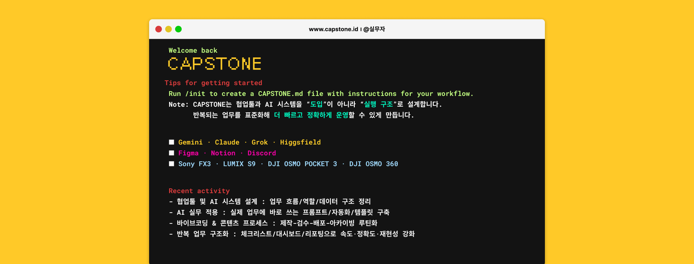
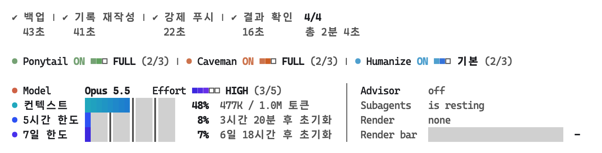

<p align="center">
  <a href="https://www.youtube.com/@%EC%8B%A4%EB%AC%B4%EC%9E%90"></a>
</p>

<h1 align="center">SINS AI SKILL &amp; TOOL</h1>

<p align="center">
  제가 주로 쓰는 AI 툴을 보다 효과적으로 사용하기 위해서 직접 제작한 스킬과 여러 툴이 담겨 있는 공간입니다.<br>
  (제 3자가 만든 스킬 및 플러그인 일부 포함)
</p>

<p align="center">
  <a href="https://www.youtube.com/@%EC%8B%A4%EB%AC%B4%EC%9E%90"></a>
  <a href="https://www.instagram.com/id.capstone"></a>
  <a href="https://www.threads.com/@id.capstone"></a>
  <a href="https://www.capstone.id"></a>
  <a href="mailto:project@capstone.id"></a>
</p>

---

## 포함된 스킬

| 명령어 | 설명 |
|--------|------|
| `/sins-card-news-creator` | 인스타그램 카드뉴스의 11필드 카드 JSON TXT·캡션 TXT·이미지 프롬프트 TXT 제작. |
| `/sins-marketing-team` | 마케팅 전략 팀 구성 및 실행. |
| `/sins-wiki-pass` | 내용을 Notion 위키 DB(LLM Wiki Index)에 정리해 저장. |
| `/sins-higgsfield` | 힉스필드 MCP로 이미지·영상을 선택 카드 따라 단계별 생성. |
| `/sins-contents-thumbstyle-prompt` | 스타일·구도·문구·서체를 단계별로 골라 유튜브 썸네일 제작. |
| `/sins-yt-subtitles` | SBV 자막을 1줄·15자 기준 유튜브 VTT 자막으로 변환. |
| `/sins-lenis` | HTML에 Lenis 부드러운 스크롤 스니펫 삽입. |
| `/sins-palmierpro-cutedit` | PalmierPro 타임라인을 읽고 문맥을 살려 무음·군소리·반복 구간 컷편집. |
| `/sins-hyp-video-creat` | HyperFrames에서 원본을 자르지 않는 비파괴 컷편집. |
| `/sins-mycontentsmake` | 유튜브 콘텐츠 자산(썸네일 프롬프트·제목·스크립트·설명)을 만들어 노션 하위 페이지로 발행. |
| `/sins-plan` | 첨부자료를 읽고 마케팅 기획 방향을 논의해 기획 브리프로 확정. |
| `/sins-autoca` | 캐러셀(카드뉴스) 원고·디자인·이미지·HTML 렌더를 서브에이전트로 자동 제작. |
| `/sins-vplanma` | 영상 스토리보드를 만들고 확정 컷으로 힉스필드 영상 생성. |

## 함께 설치되는 외부 스킬

전체 설치 때 SINS 스킬과 함께 설치됩니다. Hermes는 자체 번들이 있어 건너뜁니다.

<details>
<summary>외부 스킬 목록 (23개) 펼치기</summary>

| 이름 | 대상 | 출처 |
|------|------|------|
| Caveman | Claude / Grok | [JuliusBrussee/caveman](https://github.com/JuliusBrussee/caveman) |
| Frontend Slides | Claude 전용 | [zarazhangrui/frontend-slides](https://github.com/zarazhangrui/frontend-slides) |
| Grill Me | Claude 전용 | [mattpocock/skills](https://github.com/mattpocock/skills) |
| Handoff | Claude 전용 | [mattpocock/skills](https://github.com/mattpocock/skills) |
| Harness | Claude 전용 | [revfactory/harness](https://github.com/revfactory/harness) |
| UI/UX Pro Max | Claude 전용 | [nextlevelbuilder/ui-ux-pro-max-skill](https://github.com/nextlevelbuilder/ui-ux-pro-max-skill) |
| HyperFrames | Claude / Codex / Grok | [heygen-com/hyperframes](https://github.com/heygen-com/hyperframes) |
| Watch (claude-video) | Claude / Codex / Grok | [bradautomates/claude-video](https://github.com/bradautomates/claude-video) |
| Clone Website | Claude / Codex / Grok | [JCodesMore/ai-website-cloner-template](https://github.com/JCodesMore/ai-website-cloner-template) |
| Hypit | Claude / Codex / Grok | [hypit-ai/hypit](https://github.com/hypit-ai/hypit) |
| gstack | Claude / Codex / Grok | [garrytan/gstack](https://github.com/garrytan/gstack) |
| Superpowers | Claude / Codex / Grok | [obra/superpowers](https://github.com/obra/superpowers) |
| Ponytail | Claude / Codex / Grok | [DietrichGebert/ponytail](https://github.com/DietrichGebert/ponytail) |
| Humanize Korean | Claude / Codex / Grok | [epoko77-ai/im-not-ai](https://github.com/epoko77-ai/im-not-ai) |
| Emil Kowalski Skills | Claude / Codex / Grok | [emilkowalski/skills](https://github.com/emilkowalski/skills) |
| Stageshow | Claude / Codex / Grok | [benjitaylor/skills](https://github.com/benjitaylor/skills) |
| Insane Search | Codex 전용 | [sinmb79/codex-insane-search](https://github.com/sinmb79/codex-insane-search) |
| Insane Search | Claude 전용 | [fivetaku/insane-search](https://github.com/fivetaku/insane-search) |
| oh-my-design | Claude / Codex | [kwakseongjae/oh-my-design](https://github.com/kwakseongjae/oh-my-design) |
| Fluent Korean | Claude 전용 | [snflkd/fluent-korean](https://github.com/snflkd/fluent-korean) |
| GEO-SEO | Claude 전용 | [zubair-trabzada/geo-seo-claude](https://github.com/zubair-trabzada/geo-seo-claude) |
| Claude SEO | Claude 전용 | [AgriciDaniel/claude-seo](https://github.com/AgriciDaniel/claude-seo) |
| Open SEO MCP Skills | Claude 전용 | [Ryze-AI-Adgent/open-seo-mcp-skills](https://github.com/Ryze-AI-Adgent/open-seo-mcp-skills) |

</details>

## 설치

### 전체 설치

```bash
curl -fsSL https://raw.githubusercontent.com/CAPSTONEID/sins-clco/main/sins-skill-all-install.sh | bash -s -- claude
```

`claude` 자리에 `codex` · `hermes` · `grok` 을 넣으면 해당 도구에 설치됩니다. 옵션은 `bash` 앞에 붙입니다.

| 옵션 | 효과 |
|------|------|
| `SINS_SKIP_EXTERNAL=1` | 외부 스킬 설치 건너뜀 |
| `SINS_SKIP_OMD=1` | oh-my-design만 건너뜀 |
| `SINS_RUN_GSTACK_SETUP=1` | gstack 브라우저 빌드·Playwright setup까지 실행 |

예: `curl -fsSL https://raw.githubusercontent.com/CAPSTONEID/sins-clco/main/sins-skill-all-install.sh | SINS_SKIP_EXTERNAL=1 bash -s -- claude`

### 개별 스킬 설치

`SKILL` 에 위 표의 이름(`/` 제외)을, `DIR` 에 도구의 스킬 폴더를 넣습니다.

```bash
SKILL=sins-card-news-creator
DIR=~/.claude/skills   # Codex ~/.codex/skills · Hermes ~/.hermes/skills · Grok ~/.grok/skills
curl -fsSL https://github.com/CAPSTONEID/sins-clco/raw/main/skill-list/$SKILL.skill -o /tmp/$SKILL.skill
mkdir -p "$DIR/$SKILL" && python3 -c "import sys,zipfile; zipfile.ZipFile(sys.argv[1]).extractall(sys.argv[2])" /tmp/$SKILL.skill "$DIR/$SKILL"
```

설치 확인은 `ls ~/.claude/skills/` (Grok은 `grok inspect`). Codex는 `@~/.codex/skills/sins-card-news-creator/SKILL.md 위 내용대로 실행해줘` 처럼 파일 참조로 부릅니다.

### Grok 참고

- `~/.grok/skills/` 에 따로 설치합니다. Claude 스킬과 섞지 않으려면 `GROK_CLAUDE_SKILLS_ENABLED=false`.
- MCP(노션·힉스필드·PalmierPro)는 옮겨지지 않으니 `grok mcp add` 로 따로 등록합니다.

## 요구사항

Claude Code · Codex CLI · Hermes · Grok CLI(`npm i -g @xai-official/grok`) 중 하나, macOS / Linux.

| 스킬 | 필요한 것 |
|------|-----------|
| `/sins-higgsfield` · `/sins-contents-thumbstyle-prompt` | 힉스필드 MCP |
| `/sins-mycontentsmake` · `/sins-wiki-pass` | 노션 MCP |
| `/sins-palmierpro-cutedit` | [PalmierPro](https://github.com/palmier-io/palmier-pro) 실행 + MCP 등록(아래) · macOS 26 · Apple Silicon |
| `/sins-hyp-video-creat` | [HyperFrames](https://github.com/heygen-com/hyperframes) CLI(`npx hyperframes doctor`) + ffmpeg. HyperFrames 앱 채팅창에서 실행 |
| `/sins-plan` | (선택) insane-search · `YOUTUBE_API_KEY` · 노션·드라이브 커넥터 |
| `/sins-autoca` | 힉스필드 MCP · Figma MCP(없으면 PNG까지) · python3 + playwright(Chromium) · humanize-korean |
| `/sins-vplanma` | 힉스필드 MCP · python3 + playwright(Chromium) · ffmpeg(선택) |

PalmierPro MCP 등록 (앱 실행 중일 때 한 번):

```bash
claude mcp add --transport http palmier-pro http://127.0.0.1:19789/mcp   # Claude Code
codex mcp add palmier-pro --url http://127.0.0.1:19789/mcp               # Codex
grok mcp add --transport http palmier-pro http://127.0.0.1:19789/mcp     # Grok
```

## 설정 동기화

`CLAUDE.md` 페르소나와 caveman 자동 활성화 hook을 새 기기에 적용합니다.

```bash
curl -fsSL https://raw.githubusercontent.com/CAPSTONEID/sins-clco/main/sins-config-apply.sh | bash
```

`~/CLAUDE.md`, `~/.claude/settings.json`(SessionStart hook), Grok이 있으면 `~/.grok/rules/sins-persona.md` 에 적용됩니다.

## Claude Code mods



```bash
curl -fsSL https://raw.githubusercontent.com/CAPSTONEID/sins-clco/main/sins-mods-install.sh | bash
```

설치·업데이트 모두 이 한 줄입니다. 새 세션부터 적용됩니다.

- **usage-band** — 위 그림. 터미널 입력창 위
  - 단계 줄: 단계별·전체 소요시간, 누르면 서브에이전트 목록
  - 모드 줄: Ponytail·Caveman·Humanize, 이름을 누르면 단계 전환
  - Model·Effort: 누르면 바로 변경
  - 게이지: 컨텍스트·5시간·7일 한도
  - 오른쪽: Advisor · Subagents · 렌더 진행
- **progress-pane** — `/progress` 옆 패널. 네온 다크 흐름도(메인 세션 → Jev → 서브에이전트 카드 → 리드 복귀)와 세션 로그, 완료 기록(롤백)
- **task-progress-band** — 데스크톱 앱 입력창 위 막대

참고: 모드 줄은 해당 플러그인·스킬이 있어야 동작하고, 5시간·7일 한도는 Pro/Max 구독에서만 보입니다. 제거는 `rm -rf ~/.claude/mods/{usage-band,task-progress-band,progress-pane}` 후 `settings.json` 의 `CLAUDE_CODE_PLUGIN_DIRS` 에서 경로를 지웁니다.
